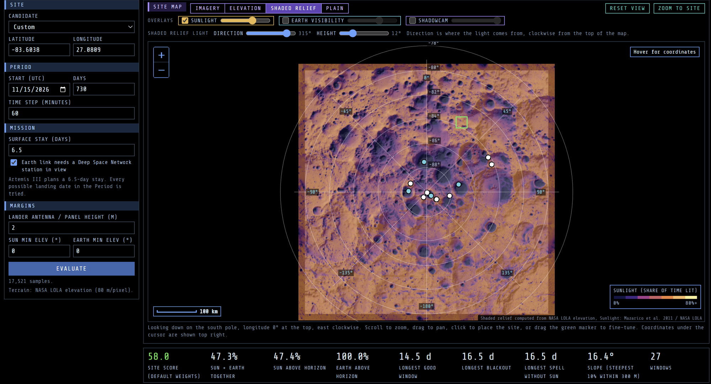
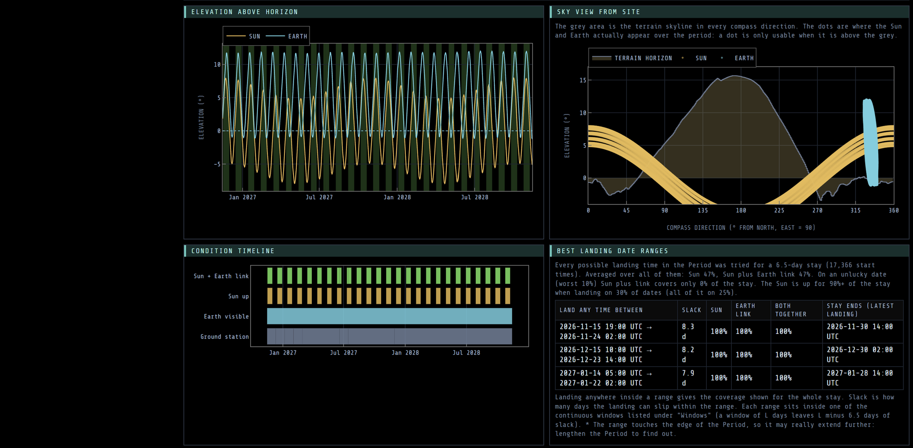
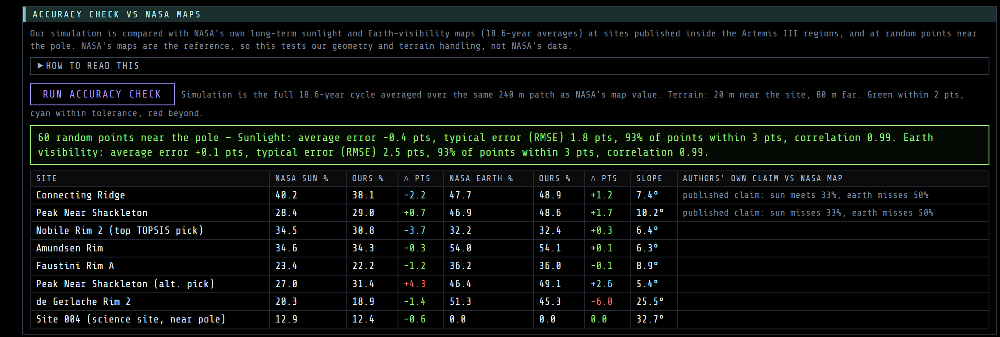
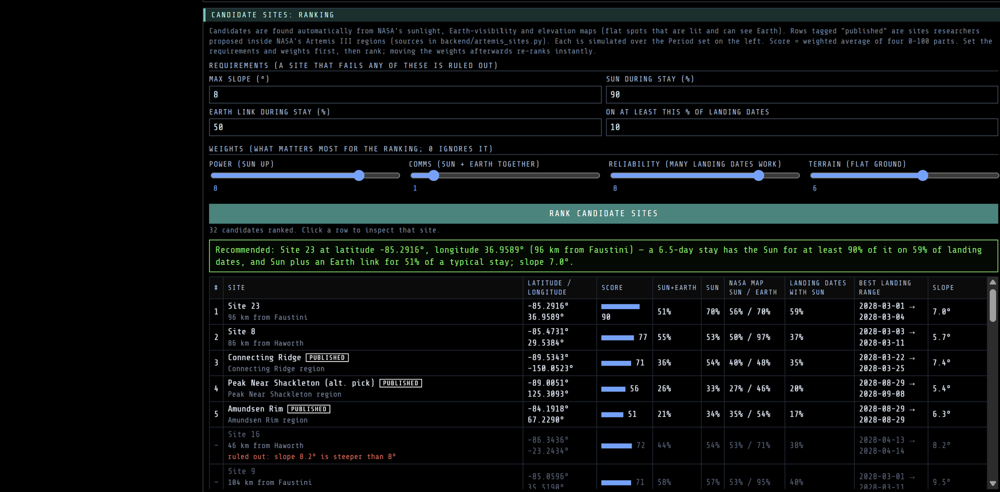

# Lunar Navigator

**Where, and when, can astronauts land at the Moon's south pole?** Lunar Navigator ranks candidate landing
spots by the two things a polar lander needs most: **sunlight** for power and a **line of sight to Earth** for
communications. It is built on real NASA data, and its answers are checked against NASA's own published maps.

- Simulates the Sun and Earth over the Moon's full 18.6-year cycle, behind the real terrain skyline.
- Finds and ranks candidate landing spots by exact latitude and longitude.
- For a mission stay (default 6.5 days, as planned for Artemis III) it tries **every possible landing date** and
  reports the best landing-date ranges.
- Lets you set hard pass/fail requirements (slope, sunlight, Earth link) and the weights that rank the survivors.
- Includes sites that researchers published inside NASA's 13 Artemis III candidate regions, with NASA's map values
  next to ours.
- Has a built-in **accuracy check** that compares the simulation to NASA's maps.

## Screenshots


*The south pole in polar projection: NASA terrain, NASA's sunlight map overlaid, candidate sites as dots.*


*For one site: Sun and Earth elevation over two years, the terrain skyline against their paths, and the best landing-date ranges.*


*The accuracy check: our simulation versus NASA's own maps.*


*Candidate sites ranked by exact coordinates, with the requirements and weights you set. Sites that fail a requirement are ruled out with the reason shown.*

## Quick start

Needs Python 3.11 and about 1 GB of free disk space for NASA data.

```
git clone https://github.com/yooanchung45/Lunar-Landing-Site-Navigator.git
cd Lunar-Landing-Site-Navigator
python -m venv .venv
.venv\Scripts\activate            # macOS/Linux: source .venv/bin/activate
pip install -r requirements.txt
python -m backend.datasets        # one-time NASA data download, ~700 MB, resumable
python -m uvicorn backend.app:app
```

Then open http://127.0.0.1:8000. On Windows, `run.bat` starts the server (it expects the `.venv` above).

- The first run also downloads about 20 MB of JPL/NAIF planetary data (cached after that).
- The 20 m terrain is fetched tile by tile, only where you look, into `~/.lunar-navigator`
  (set `LUNAR_NAVIGATOR_CACHE` to move it). It is never downloaded whole.
- The first ranking takes about a minute (it simulates every candidate); later ones take seconds.
- Until the data download finishes, the layers that need it are greyed out.

## Using it

1. **Pick a site** on the map (click, drag the marker, or choose from the list) and press **Evaluate** to see
   Sun and Earth elevation, the terrain skyline, when conditions are met, and the best landing-date ranges.
2. **Set requirements and weights**, then press **Rank candidate sites**. Each row gives a specific latitude and
   longitude. Moving the weights afterwards re-ranks instantly. Click a row to inspect that site.
3. **Run the accuracy check** to see how closely the simulation reproduces NASA's maps.

Map layers: NASA LRO imagery, LOLA elevation, shaded relief computed here, NASA's average sunlight and
Earth-visibility maps, and ShadowCam photos of permanently shadowed craters.

## How it works

1. **Where the Sun and Earth are.** JPL's DE421 ephemeris with NAIF's lunar orientation data, through Skyfield.
   Parallax is corrected for the view from the surface, and the Sun (0.27 deg radius) and Earth (about 1 deg
   radius) are finite discs: a body counts as visible once any part of its disc clears the skyline.
2. **The skyline.** From the site, rays walk outward over the elevation data in every compass direction and keep the
   steepest angle on the curved Moon. Within 8 km this uses NASA's 20 m LOLA terrain, farther out the 80 m terrain.
   The horizon is allowed to dip below the local flat plane, as on a hilltop.
3. **Windows.** A time step is usable when the Sun is above the skyline and an Earth link exists (Earth above the
   skyline and a Deep Space Network station able to see the Moon).
4. **Landing dates.** Every possible start of a stay is tried; coverage of Sun and Earth link over the stay is
   measured, and neighbouring good starts are grouped into landing-date ranges.
5. **Candidates and score.** Candidate spots are found automatically from NASA's maps (flat, lit, Earth-visible),
   refined to a single 60 m pixel. The score is a weighted average of power, comms, reliability (how many landing
   dates work) and terrain. Weights and requirements are judgement calls and are yours to change.

## Accuracy

`python -m backend.validation` (or the **Accuracy check** panel) compares the simulation with NASA's
long-term maps (Mazarico et al. 2011 products), using the full 18.6-year cycle.

Over 60 random points near the pole:

| | Average error | Typical error (RMSE) | Within 3 points | Correlation |
|---|---|---|---|---|
| Sunlight | -0.4 pts | 1.8 pts | 93% | 0.99 |
| Earth visibility | +0.05 pts | 2.5 pts | 93% | 0.99 |

At 8 sites published inside the Artemis III regions, sunlight agrees within about 4 points. The weakest is steep
ground such as de Gerlache Rim 2, where Earth visibility is 6 points low.

Notes on this check:
- NASA's map is the reference, so it tests our geometry and terrain handling, not NASA's data.
- NASA does not state the observer height behind its maps. About **0.5 m** reproduces them best, so the accuracy
  check uses that. Mission analysis uses a lander height you choose (default 2 m).
- The two papers' selection claims for Connecting Ridge and Peak Near Shackleton (at least 33% sunlight and 50%
  Earth visibility) are not all supported by NASA's maps at those exact spots.

## Limitations

- Terrain is 20 m near a site and 80 m farther out: it captures hills and rims, not boulders or small craters.
  Slope numbers are screening values, not a landing-hazard map.
- Candidate spots come from NASA's maps plus published research sites. They are **not NASA's official landing
  sites**, which NASA has not published as coordinates.
- Earth visibility ignores antenna scheduling, relay satellites and signal margins. A ground station is almost always
  in view of the Moon, so that option changes results very little.
- No battery, thermal or power-budget model. "Sunlit" means the Sun is up, not that a lander survives.
- Ephemeris covers 1900-2050.

## Project layout

| Path | What it does |
|---|---|
| `backend/app.py` | FastAPI server and API |
| `backend/providers/ephemeris.py` | Sun, Earth and ground-station positions (JPL DE421 + NAIF lunar orientation, via Skyfield) |
| `backend/providers/terrain.py`, `remote_dem.py` | LOLA terrain readers; the 20 m terrain is fetched tile by tile |
| `backend/geometry.py` | elevation/azimuth, parallax and visible fraction of a disc |
| `backend/horizon.py`, `slope.py` | terrain skyline per compass direction; slope around a site |
| `backend/pipeline.py` | wires one site's analysis together |
| `backend/mission.py` | landing-date analysis and pass/fail requirements |
| `backend/scoring.py` | the four-part score |
| `backend/candidates.py` | finds and refines candidate spots from NASA's maps |
| `backend/artemis_sites.py` | sites published inside NASA's Artemis III regions, with sources |
| `backend/validation.py`, `verify_data.py` | accuracy check against NASA's maps; data integrity audit |
| `backend/basemap.py`, `rastertiles.py`, `datasets.py` | map tiles, shaded relief, data downloads |
| `frontend/` | the interface: Leaflet map and Plotly charts, no build step |
| `tests/` | 38 tests (`python -m pytest tests`) |

## Data and credits

NASA and JPL:
- LOLA south polar elevation (80 m and 20 m), PGDA: https://pgda.gsfc.nasa.gov/products/78
- Average illumination and Earth visibility maps, PGDA: https://pgda.gsfc.nasa.gov/products/69
- Moon Trek (LRO imagery and colour elevation tiles): https://trek.nasa.gov/moon/
- ShadowCam mosaics on KARI's Danuri, NASA PDS: https://pds.shadowcam.im-ldi.com/derived/
- JPL DE421 ephemeris and lunar orientation kernels, NAIF: https://naif.jpl.nasa.gov/naif/data_generic.html
- Artemis III candidate regions: https://svs.gsfc.nasa.gov/5013

Research used for method and published site coordinates:
- Mazarico et al. 2011, *Illumination conditions of the lunar polar regions using LOLA topography*: https://doi.org/10.1016/j.icarus.2010.10.030
- Gracy and Lee, LPSC 2024: https://www.hou.usra.edu/meetings/lpsc2024/pdf/1695.pdf
- Evaluating potential landing sites for Artemis III (arXiv): https://arxiv.org/abs/2406.19863

Software: [Skyfield](https://rhodesmill.org/skyfield/), [Leaflet](https://leafletjs.com/),
[Plotly.js](https://plotly.com/javascript/), [FastAPI](https://fastapi.tiangolo.com/),
[Rasterio](https://rasterio.readthedocs.io/), NumPy, SciPy, httpx, Uvicorn.
Typeface: [Share Tech Mono](https://fonts.google.com/specimen/Share+Tech+Mono).

This project was built with the help of an AI coding assistant ([Claude Code](https://www.anthropic.com/claude-code)).

## License

MIT, see [LICENSE](LICENSE). NASA, JPL and other third-party data keep their own terms; see the credits above.
